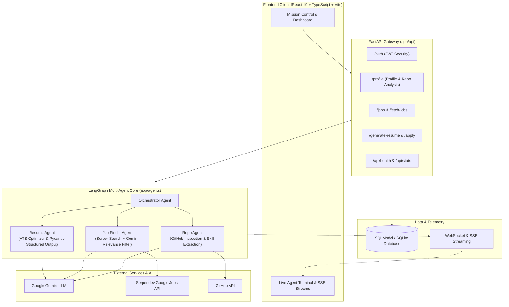

# 🎯 JobScout AI

> **Autonomous Multi-Agent Career Intelligence & Application Platform**  
> Reverse-matches real developer codebases to live tech opportunities, tailors ATS-optimised resumes, and orchestrates applications using LangGraph and Google Gemini.

---

## 🌟 Key Features

- 🧠 **Multi-Agent Orchestration**: Specialized agents collaborate via LangGraph to parse repositories, discover active listings, and optimize resumes.
- 🐙 **GitHub Codebase Intelligence**: Analyzes candidate repositories, extracting verified tech stacks, architecture patterns, and contribution depth.
- 🔍 **Real-Time Job Aggregation**: Scrapes and aggregates live listings via Serper with LLM-powered relevance scoring.
- 📄 **ATS Tailoring & Scoring**: Uses Google Gemini structured outputs to tailor resume bullet points and provide actionable ATS alignment metrics.
- ⚡ **Live Agent Telemetry**: Streaming Server-Sent Events (SSE) and WebSocket feeds provide a real-time terminal view of agent decision-making.

---

## 🏛️ System Architecture



---

## 🏗️ Project Structure

```
JobScout/
├── backend/
│   ├── app/
│   │   ├── agents/            # LangGraph multi-agent workflows
│   │   │   ├── orchestrator.py      # Workflow coordinator & graph definition
│   │   │   ├── repo_agent.py        # GitHub analyzer & skill extractor
│   │   │   ├── job_finder_agent.py  # Serper search & Gemini job scorer
│   │   │   └── resume_agent.py      # ATS resume tailoring & optimization
│   │   ├── api/               # Modular FastAPI domain routers
│   │   │   ├── auth.py              # User registration & JWT login
│   │   │   ├── profile.py           # Candidate profile CRUD & SSE repo analysis
│   │   │   ├── jobs.py              # Live fetch & DB job queries
│   │   │   ├── resume.py            # Resume generation, apply, & WebSocket logs
│   │   │   ├── health.py            # Healthcheck & application stats
│   │   │   └── deps.py              # Shared dependencies & serializers
│   │   ├── core/              # Foundational infrastructure
│   │   │   ├── config.py            # Centralised Settings (pydantic / os.getenv)
│   │   │   ├── db.py                # SQLModel engine & session generator
│   │   │   └── security.py          # Password hashing (bcrypt) & JWT helpers
│   │   ├── models/            # SQLModel database schemas
│   │   │   └── models.py            # UserProfile, Job, Application records
│   │   ├── tools/             # Utilities and integrations
│   │   │   ├── job_scraper.py       # Live SERP web scraping utility
│   │   │   └── job_tools.py         # Serper search client
│   │   ├── utils/
│   │   │   └── log_generator.py     # Simulated/live agent event streamer
│   │   └── main.py            # Application entrypoint & CORS middleware
│   ├── requirements.txt       # Python dependencies
│   ├── Procfile               # Deployment process definition
│   └── .env.example           # Backend environment template
│
├── frontend/
│   └── web/                   # Modern React SPA
│       ├── src/
│       │   ├── components/    # Reusable UI (Sidebar, Terminal, Gauges)
│       │   ├── contexts/      # AuthContext, TerminalContext
│       │   ├── pages/         # Overview, Jobs, MissionControl, Profile, Login
│       │   ├── lib/           # Axios API client
│       │   └── types.ts       # Shared TypeScript interfaces
│       ├── package.json
│       ├── vite.config.ts
│       └── index.html
│
├── render.yaml                # Render Blueprint deployment config
└── README.md
```

---

## ⚡ API Quick Reference

| Method | Endpoint | Description |
|---|---|---|
| `POST` | `/auth/register` | Register new user account |
| `POST` | `/auth/login` | Authenticate and obtain JWT access token |
| `GET` | `/profile/me` | Fetch active user profile and parsed skills |
| `POST` | `/profile/analyze-repos` | Trigger SSE stream analyzing GitHub repositories |
| `GET` | `/fetch-jobs` | Run live SERP scan and LLM job match |
| `GET` | `/jobs` | List saved jobs and match scores |
| `POST` | `/generate-resume` | Generate ATS-tailored resume for a target role |
| `POST` | `/apply` | Submit and log job application |
| `WS` | `/logs` | WebSocket stream for live agent execution telemetry |
| `GET` | `/api/health` | Service health status |

---

## 🚀 Quick Start (Local Development)

### 1. Prerequisites
- Python 3.10+
- Node.js 18+ & npm
- [Google AI Studio API key](https://aistudio.google.com/app/apikey)
- [Serper.dev API key](https://serper.dev)

### 2. Backend Setup

```bash
cd backend

# Create and activate virtual environment
python -m venv venv
source venv/bin/activate       # On Windows: venv\Scripts\activate

# Install dependencies
pip install -r requirements.txt

# Configure environment variables
cp .env.example .env
# Edit .env and insert your GOOGLE_API_KEY and SERPER_API_KEY

# Run server
uvicorn app.main:app --reload --port 8000
```
Backend API will be running at `http://localhost:8000` (Docs: `http://localhost:8000/docs`).

### 3. Frontend Setup

```bash
cd frontend/web

# Install dependencies
npm install

# Start development server
npm run dev
```
Frontend will be available at `http://localhost:5173`.

---

## ⚙️ Environment Variables

### Backend (`backend/.env`)

| Variable | Description | Default |
|---|---|---|
| `DATABASE_URL` | SQLite database connection string | `sqlite:///./jobscout.db` |
| `GOOGLE_API_KEY` | Google Gemini API Key | *Required* |
| `SERPER_API_KEY` | Serper.dev Search API Key | *Required* |
| `SECRET_KEY` | JWT secret for auth tokens | `super-secret-key-...` |
| `ALLOWED_ORIGINS` | Permitted CORS origins | `http://localhost:5173,http://127.0.0.1:5173` |

### Frontend (`frontend/web/.env.local`)

| Variable | Description | Default |
|---|---|---|
| `VITE_BACKEND_URL` | API base URL | `http://localhost:8000` |

---

## 🌐 Production Deployment

- **Backend (Render / Railway / Fly.io)**:  
  Point to the `render.yaml` blueprint or set Root Directory to `backend` with start command:
  ```bash
  uvicorn app.main:app --host 0.0.0.0 --port $PORT
  ```
- **Frontend (Vercel / Netlify / Cloudflare Pages)**:  
  Set Root Directory to `frontend/web`, Build Command to `npm run build`, and Output Directory to `dist`. Set `VITE_BACKEND_URL` to your production backend URL.

---

## 📄 License
Distributed under the MIT License.
