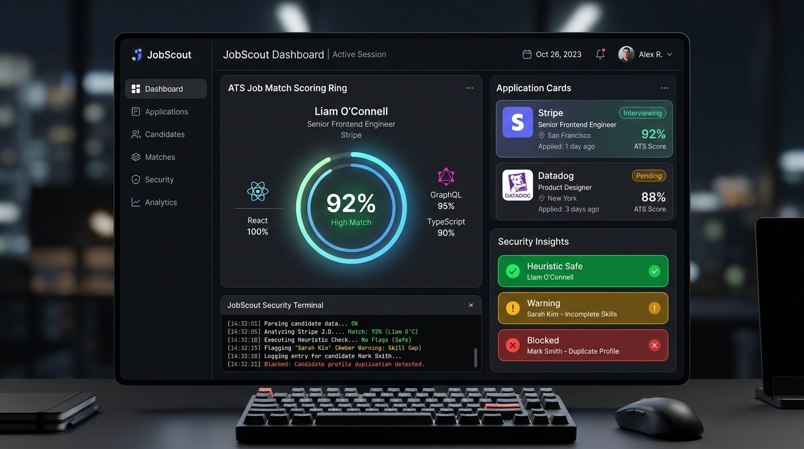

# 🎯 JobScout AI

[](https://github.com/Swastik-Jain/JobScout/actions/workflows/ci.yml)
[](LICENSE)
[](https://python.org)
[](https://fastapi.tiangolo.com)
[](https://react.dev)

> **Autonomous job search, ATS alignment, and application lifecycle platform.** Powered by direct company ATS integrations (Greenhouse, Lever, Ashby), transparent ATS scoring, and strict anti-fabrication guardrails.

---

### 🌐 Live Deployment & Preview
- **Live Web Application**: [https://jobscout-ai.vercel.app](https://jobscout-ai.vercel.app) *(or connect your custom production URL)*
- **API Documentation**: `http://localhost:8000/docs` (Swagger UI)



---

## ⚡ Core Architecture & Engineering Highlights

### 1. Direct ATS Ingestion (Zero-Scrape Waste)
- Ingests real, live public postings directly from corporate ATS boards (**Greenhouse**, **Lever**, **Ashby**).
- **Lightweight sync**: Greenhouse listings are fetched without heavy description payloads; descriptions are enriched only for top shortlisted candidates.
- **Closed job detection**: Automatic deactivation (`is_active = False`) when a job vanishes from an ATS board feed or HTTP 404/410 / closed vacancy text indicators are encountered.
- **Offline discovery**: Scheduled background discovery using Serper to discover and validate new ATS company slugs (`validate_and_register_slug`) with strict regex and verification tests, preventing per-search credit burning.

### 2. Transparent ATS Scoring (60/40 Formula)
Unlike generic tools where an LLM blindly grades its own output:
- **60% Deterministic Keyword Coverage**: Exact word-boundary regex matching across candidate profile skills, target role, and job description requirements.
- **40% Independent LLM Judge**: Evaluates architectural depth and domain relevance with strict structured JSON output.
- Full formula and breakdown transparently rendered in the UI with sub-metric gauges.

### 3. Anti-Fabrication Guardrail
- LLM resume tailoring is strictly audited by `validate_no_fabrication`:
  - Enforces that no phantom employers, degrees, or unverified projects are hallucinated.
  - Generates clear diffs against the candidate's verified baseline profile.

### 4. Client-Side Heuristic Fraud Guard
- **Transparent pattern-matching rules** running entirely in the user's browser.
- Inspects listing titles, employers, descriptions, and platforms for high-risk recruitment fraud indicators:
  - Wire transfers, Western Union, cashier check scams, crypto payments.
  - Advance-fee equipment purchases ("buy equipment from designated vendor").
  - Direct messaging interview channels (Telegram/WhatsApp handles).
  - Unrealistic salary claims (e.g. "$50/hr data entry", "earn $1000/day no experience").
- Color-coded risk tiers: `SAFE`, `WARNING`, and `BLOCKED` with modal safeguards and user overrides.
- **100% Privacy**: Zero application or candidate data sent to third parties for fraud inspection.

### 5. Application State Machine & Audit Timeline
- Enforces valid lifecycle transitions: `saved` ➔ `prepared` ➔ `applied` ➔ `interviewing` ➔ `offered` / `rejected`.
- Strict user ownership verification (`user_id` scoping) on all application and profile mutations.
- Every state advancement logs an immutable `ApplicationTimeline` audit entry.

---

## 🏗️ Repository Layout

```
JobScout/
├── .github/workflows/
│   └── ci.yml               # GitHub Actions running pytest, eslint, and tsc
├── backend/
│   ├── app/
│   │   ├── agents/          # job_finder_agent, resume_agent, repo_agent, orchestrator
│   │   ├── api/             # auth, profile, jobs, applications, resume, health
│   │   ├── core/            # config, db (SQLite/Postgres), security, logging_config
│   │   ├── models/          # SQLModel schemas (User, Job, IngestedJob, Application, etc.)
│   │   ├── services/        # application_service (state machine), resume_validator
│   │   ├── tools/           # ats_adapters (Greenhouse/Lever/Ashby), job_scraper
│   │   └── main.py          # FastAPI application entrypoint
│   ├── tests/               # Pytest suite (auth, ownership, adapters, closed-jobs)
│   ├── alembic/             # Database migrations
│   ├── requirements.txt     # Pinned Python dependencies
│   └── pytest.ini           # Pytest configuration
└── frontend/
    └── web/                 # React 19 + TypeScript + Vite + TailwindCSS
        ├── src/
        │   ├── components/  # OptimizationGauge, ReviewModal, Navbar, Sidebar
        │   ├── contexts/    # AuthContext, TerminalContext (WebSocket logs)
        │   ├── lib/         # api client, fraudHeuristics (extracted rules & badges)
        │   └── pages/       # MissionControl, Overview, Profile, Login, Register
        └── README.md        # Frontend architecture & component guide
```

---

## 🧪 Testing & CI/CD

Both backend and frontend are tested in continuous integration on every push and pull request via GitHub Actions:

```bash
# 1. Run Backend Pytest Suite (Auth, Ownership, Adapters, Closed-Job Detection)
cd backend
source venv/bin/activate
pytest tests/ -v

# 2. Run Frontend Quality Checks (ESLint + TypeScript Typecheck)
cd frontend/web
npm run lint
npx tsc -b
```

---

## 🚀 Quick Start (Local Setup)

### 1. Prerequisites
- Python 3.9+
- Node.js 20+ & npm

### 2. Backend Setup
```bash
cd backend
python3 -m venv venv
source venv/bin/activate        # Windows: venv\Scripts\activate
pip install -r requirements.txt
cp .env.example .env            # Configure GOOGLE_API_KEY, SECRET_KEY
uvicorn app.main:app --reload --port 8000
```

### 3. Frontend Setup
```bash
cd frontend/web
npm install
npm run dev                     # Starts Vite dev server at http://localhost:5173
```

---

## ⚙️ Environment Variables

### Backend (`backend/.env`)

| Variable | Description |
|---|---|
| `DATABASE_URL` | SQLite path or PostgreSQL connection string (`postgresql://...`) |
| `SECRET_KEY` | Secret key for JWT cryptographic signatures |
| `GOOGLE_API_KEY` | Google AI Studio API key for Gemini 2.0 / 1.5 model chain |
| `SERPER_API_KEY` | (Optional) Serper.dev API key for scheduled offline ATS discovery |
| `GITHUB_TOKEN` | (Optional) GitHub token for repo intelligence API rate limits |
| `ALLOWED_ORIGINS` | Comma-separated allowed CORS origins |

### Frontend (`frontend/web/.env.local`)

| Variable | Description |
|---|---|
| `VITE_API_URL` | Backend URL for production (defaults to local Vite proxy in dev) |

---

## 📄 License
MIT License. Built for autonomous job tracking and career development.
